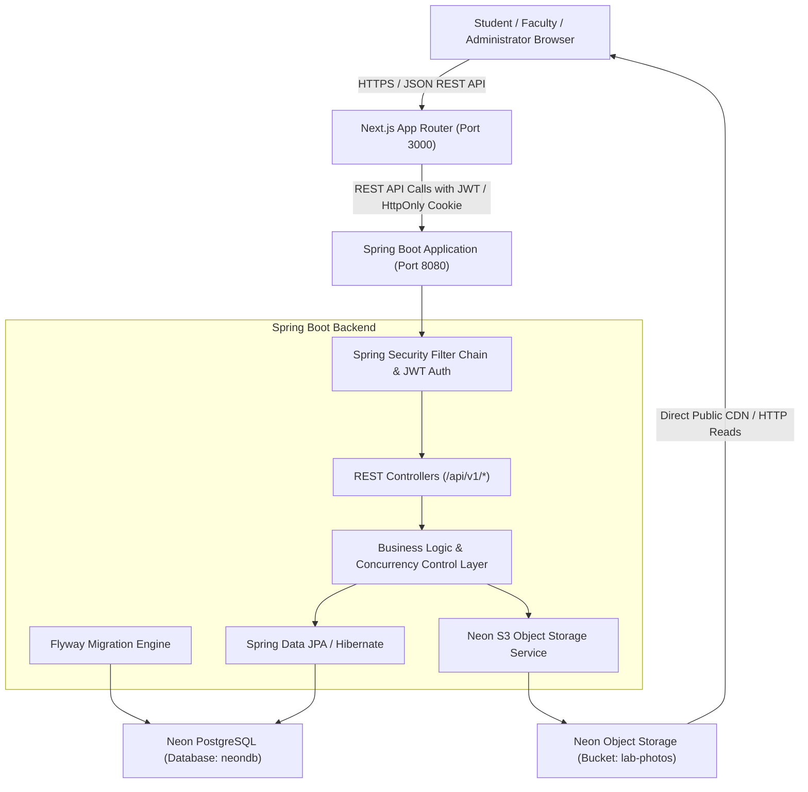

# System Architecture

## Overview

The **TCET Lab Inventory & Lending System** is a full-stack, enterprise-grade laboratory equipment lending and inventory tracking platform tailored for Thakur College of Engineering and Technology (TCET), Mumbai. It enables students and faculty to discover laboratory rooms across departments, inspect live equipment availability, submit lending requests for academic experiments, track returns, and report damage. Administrators maintain laboratory rooms, inventory, equipment lifecycle states, equipment photos, return approvals, and maintenance records.

## System Topology & Boundaries

## Security & Authentication Boundaries

1. **Email Domain Enforced on Server**:
   - Only addresses ending in `@tcetmumbai.org` are permitted to register and authenticate.
   - Domain validation is performed on both the client (for prompt user feedback) and rigidly enforced in the Spring Boot security layer.
   - Lookalike domains (e.g. `tcetmumbai.org.xyz`) are rejected by strict regex anchor checks (`^[a-zA-Z0-9._%+-]+@tcetmumbai\.org$`).

2. **Role-Based Access Control (RBAC)**:
   - Server-enforced roles: `STUDENT`, `FACULTY`, `ADMIN`.
   - Administrative endpoints (`/api/v1/admin/**`) are strictly guarded with `@PreAuthorize("hasRole('ADMIN')")` and Spring Security URL patterns.
   - The server resolves the authenticated identity directly from the cryptographically verified JWT / security context. Client-supplied headers, roles, or dropdown selections are never trusted to grant privileges.

3. **Storage Security Model**:
   - Storage credentials (`AWS_ACCESS_KEY_ID`, `AWS_SECRET_ACCESS_KEY`, `AWS_ENDPOINT_URL_S3`) reside solely in the Spring Boot backend environment.
   - Frontend clients never receive storage access keys.
   - File uploads pass through backend validation: mime type checks (JPEG, PNG, WebP), file size limits (max 5 MB), safe UUID object keys (`departments/{deptId}/rooms/{roomId}/{uuid}.{ext}`).
   - The bucket `lab-photos` is configured as `public_read`, allowing high-performance direct CDN reads for browsers while strictly restricting write/delete operations to authenticated administrators via the backend.

4. **Concurrency & Data Consistency**:
   - Stock issuance and reservations utilize database transactions with pessimistic row locking (`PESSIMISTIC_WRITE`) on inventory entities to prevent over-allocation during concurrent request approvals.
   - State transitions (Requested -> Approved -> Issued -> Returned -> Inspected) follow a deterministic state machine.
