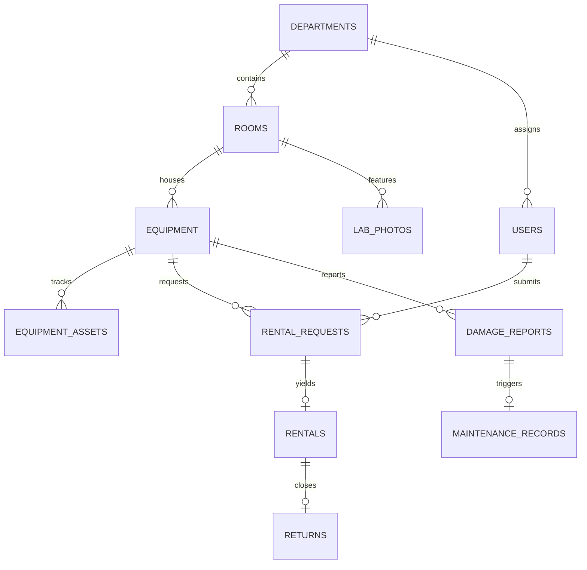

# Database Schema & Entity Specification

## Schema Design

The schema is built for PostgreSQL 14+ on Neon, managed with Flyway migrations (`V1__init_schema.sql`, `V2__seed_departments_and_rooms.sql`).

### 1. `departments`
- `id` (BIGSERIAL, PRIMARY KEY)
- `code` (VARCHAR(30), UNIQUE, NOT NULL) — e.g. `COMP`, `IT`, `AI_ML`, `AI_DS`, `CYBER`, `IOT`, `MME`, `ETC`, `ECS`, `CIVIL`, `FIRST_YEAR`
- `name` (VARCHAR(150), NOT NULL)
- `active` (BOOLEAN, DEFAULT TRUE)

### 2. `rooms`
- `id` (BIGSERIAL, PRIMARY KEY)
- `department_id` (BIGINT, REFERENCES `departments(id)`, NOT NULL)
- `room_number` (VARCHAR(50), NOT NULL)
- `room_name` (VARCHAR(150))
- `lab_type` (VARCHAR(100))
- `is_confirmed` (BOOLEAN, DEFAULT TRUE) — Preserves duplicate room 413 flagged for admin review
- `active` (BOOLEAN, DEFAULT TRUE)
- `created_at` (TIMESTAMPTZ, NOT NULL)
- `updated_at` (TIMESTAMPTZ, NOT NULL)
- **Constraint**: Unique combination on `(department_id, room_number)` ensures room numbers are scoped to departments and duplicate appearances across departments (like Room 413 in AI&ML and AI&DS) are preserved correctly without collisions.

### 3. `users`
- `id` (BIGSERIAL, PRIMARY KEY)
- `full_name` (VARCHAR(150), NOT NULL)
- `email` (VARCHAR(150), UNIQUE, NOT NULL) — Restricted to `@tcetmumbai.org`
- `password_hash` (VARCHAR(255), NOT NULL) — Argon2id / BCrypt hash
- `department_id` (BIGINT, REFERENCES `departments(id)`)
- `studying_year` (VARCHAR(30)) — `FE`, `SE`, `TE`, `BE`, `FACULTY`, `STAFF`
- `role` (VARCHAR(30), NOT NULL) — `STUDENT`, `FACULTY`, `ADMIN`
- `active` (BOOLEAN, DEFAULT TRUE)
- `created_at` (TIMESTAMPTZ, NOT NULL)
- `updated_at` (TIMESTAMPTZ, NOT NULL)

### 4. `equipment`
- `id` (BIGSERIAL, PRIMARY KEY)
- `name` (VARCHAR(200), NOT NULL)
- `category` (VARCHAR(100), NOT NULL) — e.g. `OSCILLOSCOPE`, `MICROCONTROLLER`, `ROBOTICS`, `NETWORKING`, `MULTIMETER`, `OPTICS`
- `description` (TEXT)
- `model_number` (VARCHAR(100))
- `department_id` (BIGINT, REFERENCES `departments(id)`, NOT NULL)
- `room_id` (BIGINT, REFERENCES `rooms(id)`, NOT NULL)
- `tracking_mode` (VARCHAR(30), NOT NULL) — `QUANTITY` vs `INDIVIDUAL`
- `total_quantity` (INT, NOT NULL, DEFAULT 1)
- `available_quantity` (INT, NOT NULL, DEFAULT 1)
- `equipment_condition` (VARCHAR(50), NOT NULL) — `EXCELLENT`, `GOOD`, `FAIR`, `DAMAGED`
- `maintenance_status` (VARCHAR(50), NOT NULL) — `OPERATIONAL`, `UNDER_MAINTENANCE`, `RETIRED`
- `created_at` (TIMESTAMPTZ, NOT NULL)
- `updated_at` (TIMESTAMPTZ, NOT NULL)

### 5. `equipment_assets`
- `id` (VARCHAR(100), PRIMARY KEY) — Unique asset barcode/RFID tag
- `equipment_id` (BIGINT, REFERENCES `equipment(id)`, NOT NULL)
- `room_id` (BIGINT, REFERENCES `rooms(id)`, NOT NULL)
- `current_condition` (VARCHAR(50), NOT NULL)
- `status` (VARCHAR(50), NOT NULL) — `AVAILABLE`, `RENTED`, `UNDER_MAINTENANCE`, `RETIRED`
- `created_at` (TIMESTAMPTZ, NOT NULL)

### 6. `rental_requests`
- `id` (BIGSERIAL, PRIMARY KEY)
- `requester_id` (BIGINT, REFERENCES `users(id)`, NOT NULL)
- `equipment_id` (BIGINT, REFERENCES `equipment(id)`, NOT NULL)
- `asset_id` (VARCHAR(100), REFERENCES `equipment_assets(id)`)
- `requested_quantity` (INT, NOT NULL, DEFAULT 1)
- `start_time` (TIMESTAMPTZ, NOT NULL)
- `end_time` (TIMESTAMPTZ, NOT NULL)
- `purpose` (TEXT, NOT NULL)
- `status` (VARCHAR(50), NOT NULL) — `PENDING`, `APPROVED`, `REJECTED`, `CANCELLED`
- `decision_by` (BIGINT, REFERENCES `users(id)`)
- `decision_time` (TIMESTAMPTZ)
- `rejection_reason` (TEXT)
- `created_at` (TIMESTAMPTZ, NOT NULL)
- `updated_at` (TIMESTAMPTZ, NOT NULL)

### 7. `rentals`
- `id` (BIGSERIAL, PRIMARY KEY)
- `request_id` (BIGINT, REFERENCES `rental_requests(id)`, NOT NULL)
- `borrower_id` (BIGINT, REFERENCES `users(id)`, NOT NULL)
- `equipment_id` (BIGINT, REFERENCES `equipment(id)`, NOT NULL)
- `asset_id` (VARCHAR(100), REFERENCES `equipment_assets(id)`)
- `quantity_issued` (INT, NOT NULL)
- `issued_by` (BIGINT, REFERENCES `users(id)`, NOT NULL)
- `issued_at` (TIMESTAMPTZ, NOT NULL)
- `expected_return_at` (TIMESTAMPTZ, NOT NULL)
- `actual_return_at` (TIMESTAMPTZ)
- `status` (VARCHAR(50), NOT NULL) — `ACTIVE`, `RETURNED`, `OVERDUE`

### 8. `returns`
- `id` (BIGSERIAL, PRIMARY KEY)
- `rental_id` (BIGINT, REFERENCES `rentals(id)`, NOT NULL)
- `recorded_by` (BIGINT, REFERENCES `users(id)`, NOT NULL)
- `returned_at` (TIMESTAMPTZ, NOT NULL)
- `return_condition` (VARCHAR(50), NOT NULL) — `WORKING`, `DAMAGED`, `REQUIRES_MAINTENANCE`
- `notes` (TEXT)

### 9. `damage_reports`
- `id` (BIGSERIAL, PRIMARY KEY)
- `equipment_id` (BIGINT, REFERENCES `equipment(id)`, NOT NULL)
- `asset_id` (VARCHAR(100), REFERENCES `equipment_assets(id)`)
- `rental_id` (BIGINT, REFERENCES `rentals(id)`)
- `reporter_id` (BIGINT, REFERENCES `users(id)`, NOT NULL)
- `category` (VARCHAR(100), NOT NULL) — `PHYSICAL`, `ELECTRICAL`, `MISSING_PARTS`, `MALFUNCTION`
- `description` (TEXT, NOT NULL)
- `photo_url` (VARCHAR(500))
- `status` (VARCHAR(50), NOT NULL) — `OPEN`, `INVESTIGATING`, `SENT_TO_MAINTENANCE`, `RESOLVED`
- `created_at` (TIMESTAMPTZ, NOT NULL)
- `resolved_at` (TIMESTAMPTZ)

### 10. `maintenance_records`
- `id` (BIGSERIAL, PRIMARY KEY)
- `equipment_id` (BIGINT, REFERENCES `equipment(id)`, NOT NULL)
- `asset_id` (VARCHAR(100), REFERENCES `equipment_assets(id)`)
- `damage_report_id` (BIGINT, REFERENCES `damage_reports(id)`)
- `reason` (TEXT, NOT NULL)
- `notes` (TEXT)
- `status` (VARCHAR(50), NOT NULL) — `SCHEDULED`, `IN_PROGRESS`, `COMPLETED`
- `admin_id` (BIGINT, REFERENCES `users(id)`, NOT NULL)
- `started_at` (TIMESTAMPTZ, NOT NULL)
- `completed_at` (TIMESTAMPTZ)

### 11. `lab_photos`
- `id` (BIGSERIAL, PRIMARY KEY)
- `room_id` (BIGINT, REFERENCES `rooms(id)`, NOT NULL)
- `department_id` (BIGINT, REFERENCES `departments(id)`, NOT NULL)
- `storage_key` (VARCHAR(300), NOT NULL, UNIQUE)
- `public_url` (VARCHAR(500), NOT NULL)
- `original_filename` (VARCHAR(255), NOT NULL)
- `mime_type` (VARCHAR(100), NOT NULL)
- `file_size` (BIGINT, NOT NULL)
- `caption` (VARCHAR(300))
- `is_primary` (BOOLEAN, DEFAULT FALSE)
- `uploaded_by` (BIGINT, REFERENCES `users(id)`, NOT NULL)
- `created_at` (TIMESTAMPTZ, NOT NULL)

### 12. `audit_logs`
- `id` (BIGSERIAL, PRIMARY KEY)
- `actor_id` (BIGINT)
- `actor_email` (VARCHAR(150), NOT NULL)
- `action` (VARCHAR(100), NOT NULL)
- `entity_type` (VARCHAR(100), NOT NULL)
- `entity_id` (VARCHAR(100), NOT NULL)
- `details` (TEXT)
- `ip_address` (VARCHAR(100))
- `created_at` (TIMESTAMPTZ, NOT NULL)
